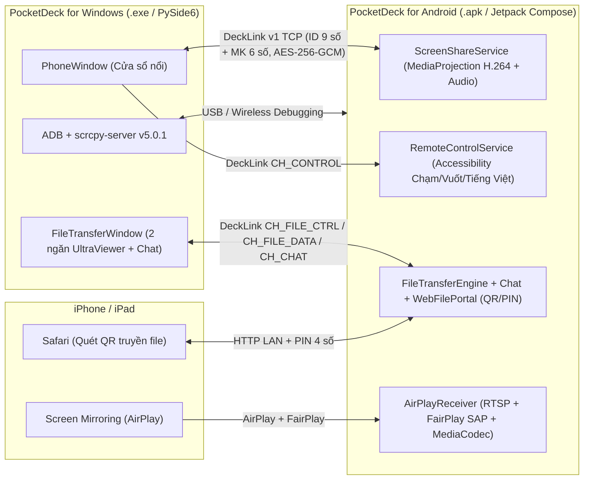

# PocketDeck

> **Chiếu màn hình, điều khiển từ xa, nhận AirPlay từ iPhone và Truyền File 2 chiều + Chat kiểu UltraViewer** cho **Android & Windows** — lấy cảm hứng từ [PocketPane](https://github.com/HienPhuong99/pocketpane) nhưng được thiết kế trọn bộ cho hệ sinh thái Android và Windows.

---

## Điểm nổi bật

PocketDeck cung cấp **cả 2 phiên bản đầy đủ** trong cùng một kho mã nguồn, nói chuyện trực tiếp với nhau qua giao thức ghép kênh bảo mật **DeckLink v1 (`AES-256-GCM`)**:

| Tính năng | PocketDeck for Windows (`windows/`) | PocketDeck for Android (`android/`) |
| :--- | :---: | :---: |
| **Cửa sổ nổi hình điện thoại** (tự xoay dọc/ngang, ghim trên cùng, PiP) | Có (`PhoneWindow` không viền) | Có (`ViewerActivity` + Picture-in-Picture) |
| **Kết nối ID 9 số + Mật khẩu 6 số kiểu UltraViewer** | Có (Máy khách & Máy chủ) | Có (Máy chủ chia sẻ & Máy khách điều khiển) |
| **Truyền File 2 ngăn + Chat trực tiếp kiểu UltraViewer** | Có (`FileTransferWindow`, `Ctrl+F`) | Có (`FileTransferTab` 2 ngăn + Hàng đợi + Chat) |
| **Kiểm tra toàn vẹn SHA-256 & Tự nối tiếp file dở (`.pocketdeck.part`)** | Có (khối `256 KiB`) | Có (khối `256 KiB`) |
| **Kết nối qua USB / Wireless Debugging không cần cài app trước** | Có (`ADB` + `scrcpy-server` v5.0.1) | Hỗ trợ nhận lệnh từ Windows |
| **Cài APK sang điện thoại 1 chạm qua cáp USB** | Có (`SetupWizard` nhúng sẵn APK) | File APK dựng sẵn tại [`dist-apk/PocketDeck-debug.apk`](dist-apk/PocketDeck-debug.apk) |
| **Đầu nhận phản chiếu iPhone / iPad (AirPlay Receiver + FairPlay SAP)** | Đã có trên [PocketPane](https://github.com/HienPhuong99/pocketpane) | **Có sẵn ngay trên Android!** (`AirPlayReceiver` + `PlayFair.kt`) |
| **Cổng Web QR + PIN truyền file nhanh với iPhone / Trình duyệt** | — | Có (`WebFilePortal` HTTP LAN + mã PIN 4 số) |
| **Quay video màn hình `.mp4` (Fragmented MP4 an toàn) & Chụp ảnh `.png`** | Có (`Recorder` tự tách file khi xoay màn hình) | — |
| **Gõ Tiếng Việt có dấu đầy đủ (Unicode)** | Có (qua DeckLink & ADB Clipboard IME) | Có (`AccessibilityService` `ACTION_SET_TEXT`) |

---

## Kiến trúc Tổng quan



---

## Bắt đầu nhanh

### 1. Cài đặt lên điện thoại / máy tính bảng / Android TV
- File cài đặt đã được biên dịch và ký sẵn tại: **[`dist-apk/PocketDeck-debug.apk`](dist-apk/PocketDeck-debug.apk)** (~20.8 MB, Android 8.0+ / API 26+).
- Chép file `.apk` sang điện thoại để cài đặt, **hoặc** cắm cáp USB vào máy tính và bấm **Trợ lý Cài đặt APK 1 chạm** ngay trong ứng dụng Windows.

### 2. Chạy PocketDeck trên Windows
- **Cách 1 — Tự động cài đặt & tạo biểu tượng Desktop**:
  Nháy đúp vào [`install.bat`](install.bat), sau đó mở **PocketDeck** ngoài màn hình Desktop hoặc chạy [`run.bat`](run.bat).
- **Cách 2 — Đóng gói ra file chạy độc lập `PocketDeck.exe`** (nhúng sẵn cả `PocketDeck-android.apk` + `adb.exe` + `scrcpy-server`):
  ```bat
  build.bat
  ```
  File thực thi độc lập sẽ nằm tại `dist\PocketDeck\PocketDeck.exe`.

### 3. Tự biên dịch lại APK Android từ mã nguồn
```bat
build-android.bat
```
Lệnh trên tự động chạy bộ kiểm thử JUnit (gồm cả 21 vector giải mã FairPlay thực tế từ iPhone) và xuất file APK mới ra `dist-apk\PocketDeck-debug.apk`.

### 4. Chạy toàn bộ Kiểm thử Tự động (Android + Windows + Cầu nối trực tiếp Python ↔ Kotlin)
```bat
test-all.bat
```

---

## Phím tắt trên Cửa sổ Điện thoại Windows (`PhoneWindow`)

| Phím tắt | Chức năng |
| :--- | :--- |
| **Chuột trái / Kéo chuột** | Chạm (`Tap`) / Vuốt (`Swipe`) trên màn hình Android |
| **Con lăn chuột / Chuột phải** | Cuộn trang (`Scroll`) / Nút **Quay lại (Back)** |
| **Gõ bàn phím trực tiếp** | Nhập chữ (hỗ trợ đầy đủ Tiếng Việt Unicode) sang ô nhập trên Android |
| **`Ctrl + F`** | Mở cửa sổ **Truyền File 2 ngăn & Chat kiểu UltraViewer** |
| **`Ctrl + K`** | Mở bảng **Kết nối Đối tác** (ID + Mật khẩu / ADB / Quét mạng LAN) |
| **`Ctrl + S`** | Chụp ảnh màn hình điện thoại ra `.png` |
| **`Ctrl + R`** | Bắt đầu / Dừng quay video màn hình `.mp4` (có âm thanh) |
| **`Ctrl + T`** | Bật / Tắt ghim cửa sổ luôn nổi trên cùng (`Always on Top`) |
| **`Home` / `Backspace` / `Esc`** | Nút Màn hình chính (`Home`) / Xoá ký tự / Quay lại (`Back`) |

---

## Cấu trúc Thư mục

```text
PocketDeck/
├── android/                  # Mã nguồn PocketDeck for Android (Kotlin + Jetpack Compose Material 3)
│   └── app/src/
│       ├── main/java/com/pocketdeck/android/
│       │   ├── airplay/      # Đầu nhận AirPlay RTSP, BinaryPlist, Pairing Ed25519/X25519 & PlayFair SAP
│       │   ├── discovery/    # Quảng bá & tìm thiết bị mạng LAN (JmDNS + UDP 7201)
│       │   ├── media/        # Giải mã H.264 phần cứng MediaCodec & phát âm thanh AudioTrack
│       │   ├── protocol/     # Lõi DeckLink v1, FileTransferEngine 2 chiều & WebFilePortal QR
│       │   ├── services/     # ScreenShareService (MediaProjection) & RemoteControlService (Accessibility)
│       │   ├── state/        # PocketDeckEngine quản lý trạng thái toàn cục
│       │   └── ui/           # Giao diện 4 tab Material 3 + ViewerActivity hỗ trợ Picture-in-Picture
│       └── test/             # Kiểm thử JUnit (DeckLink, Path traversal, 21 vector FairPlay, Cầu nối TCP)
├── windows/                  # Mã nguồn PocketDeck for Windows (Python 3.11+ / PySide6 / PyAV)
│   ├── pocketdeck/
│   │   ├── adb/              # Quản lý ADB, scrcpy v5.0.1 stream/control & hệ thống file ADB
│   │   ├── media/            # Giải mã H.264, phát âm thanh PCM/Opus/AAC & quay Fragmented MP4
│   │   ├── protocol/         # Giao thức DeckLink v1 & FileTransferManager 2 chiều kiểu UltraViewer
│   │   └── ui/               # PhoneWindow, FileTransferWindow, ConnectDialog, SetupWizard, Settings
│   ├── tools/                # Giả lập FakeAndroid, tạo icon .ico, tải công cụ Android & tạo shortcut
│   └── tests/                # 17 bài kiểm thử tự động (Unit, E2E, UI offscreen, Python<->Kotlin TCP Bridge)
├── dist-apk/                 # Chứa bản dựng sẵn PocketDeck-debug.apk cài được ngay lên Android
├── docs/                     # Tài liệu kiến trúc (PLAN.md), giao thức (PROTOCOL.md), báo cáo (REPORT.md)
├── licenses/                 # Giấy phép thành phần mã nguồn mở (PlayFair GPL-3.0, scrcpy Apache-2.0)
├── HUONG-DAN.md              # Hướng dẫn sử dụng chi tiết từng bước bằng Tiếng Việt
├── install.bat               # Cài đặt tự động trên Windows
├── run.bat                   # Khởi chạy nhanh PocketDeck trên Windows
├── build.bat                 # Đóng gói PocketDeck.exe độc lập bằng PyInstaller
├── build-android.bat         # Biên dịch PocketDeck-debug.apk bằng Gradle Wrapper
└── test-all.bat              # Chạy trọn bộ kiểm thử tự động đa nền tảng
```

---

## Tài liệu Chi tiết
- [**Hướng dẫn Sử dụng Tiếng Việt từng bước (`HUONG-DAN.md`)**](HUONG-DAN.md)
- [**Kế hoạch & Kiến trúc Hệ thống (`docs/PLAN.md`)**](docs/PLAN.md)
- [**Đặc tả Giao thức DeckLink v1 (`docs/PROTOCOL.md`)**](docs/PROTOCOL.md)
- [**Báo cáo Kỹ thuật, Công cụ Đã cài & Kiểm định (`docs/REPORT.md`)**](docs/REPORT.md)

## Giấy phép & Ghi công
Dự án được phát hành theo giấy phép **[GNU General Public License v3.0 (`LICENSE`)](LICENSE)**:
- Thuật toán giải mã khóa phiên FairPlay SAP trên Android (`PlayFair.kt` / `FairPlayGarble.kt` / `FairPlayTables.kt`) được chuyển ngữ sang Kotlin từ thư viện PlayFair (GPL-3.0) và lấy cảm hứng từ [PocketPane](https://github.com/HienPhuong99/pocketpane) — xem [`licenses/playfair-LICENSE.md`](licenses/playfair-LICENSE.md).
- Chế độ kết nối USB / Gỡ lỗi không dây sử dụng `adb` và `scrcpy-server` từ dự án [Genymobile/scrcpy](https://github.com/Genymobile/scrcpy) (Apache-2.0) — xem [`licenses/scrcpy-LICENSE.txt`](licenses/scrcpy-LICENSE.txt).
